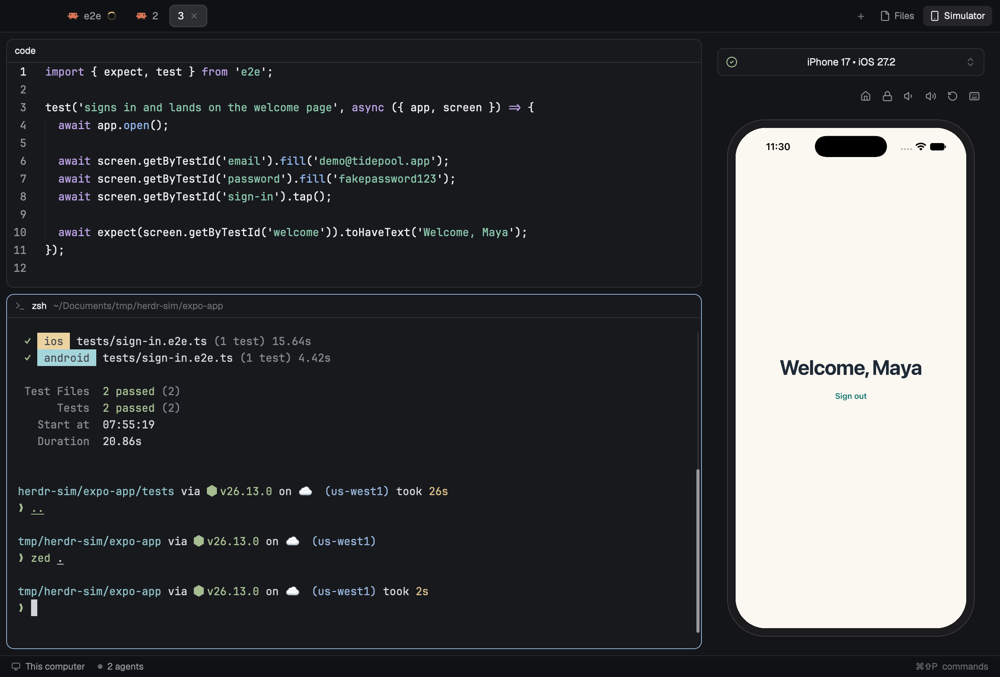

# Herdr Sim

Your iOS simulator and Android emulator, live inside [Herdr](https://herdr.dev), next to your code and terminals.



Pick any simulator or emulator on your Mac and use it right in Herdr. Run your mobile tests and watch them tap through the app while the results print beside it.

## What you can do

- **See the device live.** The screen updates about 30 times a second.
- **Use it in place.** Click to tap, drag to swipe, scroll with your mouse or trackpad, and type with your keyboard. The buttons above the screen press Home, Lock and the volume keys, rotate the device, and on iOS show or hide the on-screen keyboard.
- **Switch devices.** The picker lists every iOS simulator and Android emulator on your Mac, with the running ones marked green. Pick one that's off and it starts. Android emulators run without a window of their own.
- **Put it where you want it.** Open it from a Simulator button in the tab bar, next to Files and Changes, or as a pane in any layout.
- **Watch your tests.** With [e2e](https://e2e.tester.army), the device opens by itself when a test run starts.
- **Fix stuck taps.** On Xcode 27, taps on a simulator sometimes stop working. Repair input in the picker fixes them. It restarts SpringBoard, so open apps close.

## Install

Ask your Herdr agent to "add the layout at github.com/wobsoriano/herdr-sim".

Or by hand:

```sh
git clone https://github.com/wobsoriano/herdr-sim
cd herdr-sim
cp -R mods/simdock mods/simdock-screen mods/tabs-simdock ~/.config/herdr-app/mods/
cp layouts/simdock.json ~/.config/herdr-app/layouts/
herdr-app do layout.switch --name simdock
```

Then add the two shortcuts in [keys.json](keys.json) to `~/.config/herdr-app/keys.json`. In Herdr, the layout and the mod are both named `simdock`.

If you only want the pane, copy `mods/simdock` and `mods/simdock-screen` and skip the rest.

You need macOS, Xcode with at least one simulator, and Node. For Android you also need the Android SDK and an emulator image built for your Mac's chip.

## Use it

### From the tab bar

Switch to the `simdock` layout. Click **Simulator** next to Files and Changes, or press ⌘⇧S. Click it again to close the panel. Each space remembers whether the panel was open.

### As a pane

In any other layout, press ⌘⇧S, or run:

```sh
herdr-app do pane.split --direction right --mod simdock
```

Close it like any other pane.

### With e2e

Copy [`e2e/herdr-simdock.ts`](e2e/herdr-simdock.ts) into your project and add it to your config's reporters:

```ts
import { herdrSimdock } from './e2e/herdr-simdock';

export default {
  // ...
  reporters: ['list', herdrSimdock()],
};
```

When `e2e run` starts in a Herdr terminal, the device opens in the panel, or as a pane beside your tests in other layouts. Your keyboard stays in the terminal. It shows the device you picked last, so pick the one your tests run on.

## What it runs on your Mac

Herdr Sim sends nothing over the internet itself.

- For iOS it runs Xcode's simulator tools and [serve-sim](https://github.com/EvanBacon/serve-sim), which downloads from npm the first time.
- For Android it runs `adb` and the emulator from your Android SDK, plus a small helper that comes with the mod.
- It saves the latest frames of the screen as image files in its own folder, because Herdr shows pictures from files.

## Limits

- It works on macOS only. It's tested with Herdr 0.1.13, Xcode 27 and Android emulator 37.2.
- The picture is about 0.2 seconds behind the device, because Herdr takes that long to show a changed image. Taps and typing reach the device right away.
- Showing an iPhone takes about 175 MB of memory.
- The e2e reporter doesn't switch the picker to the device your tests run on.
- The Simulator button lives in a copy of Herdr 0.1.13's tab bar. If a Herdr update changes the tab bar, this copy keeps the old one until it's updated here.

## License

MIT, see [LICENSE](LICENSE). The tab bar in `mods/tabs-simdock` is adapted from Herdr's own and keeps Herdr's Apache-2.0 license, in `mods/tabs-simdock/LICENSE`. The icons are from [Lucide](https://lucide.dev) under the ISC license, except the Android icon.
