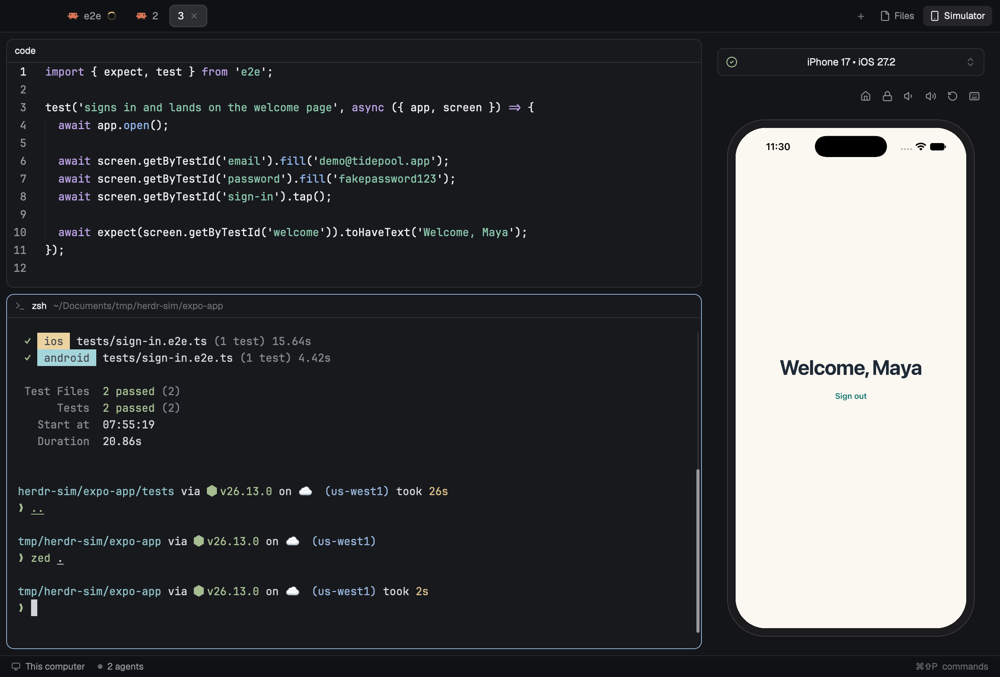

# Herdr Sim

Herdr's main window with a live phone in it: a **Simulator** button after Files
and Changes opens the picked iOS simulator or Android emulator in the
right-hand panel, where the person taps, swipes and types on it while their
code and tests run beside it. The same view opens as a pane in any layout, and
an e2e reporter shows it when a test run starts.

## What you see

- **Everything of Herdr's `main` layout** (sidebar, tab bar, panes, status
  bar), with one more button in the tab bar: **Simulator**, a 14px
  `smartphone` icon and the label, after Files and Changes, styled like them
  (26px tall, 6px radius, `selected` background while its panel shows).
- **The panel** (368px wide by default, 280 to 900px) shows the `herdr-sim`
  view, top to bottom, with 12px padding and 12px gaps:
  - **Device selector**, 36px tall, 8px radius, `surface` background, 1px
    `border` border (`input` on hover): a 15px `circle-check` icon (`ansi2`
    green while streaming, `blocked` on an error, `dim` otherwise), the
    centered 13px text `iPhone 17 • iOS 27.2` (or `Select device`), and a 14px
    `chevrons-up-down` icon.
  - **Toolbar**, 28px tall, right-aligned 26px icon buttons (14px icons, `muted`,
    `hover` background, half opacity until the device is live): Home (`house`),
    Lock (`lock`), Volume down (`volume-1`), Volume up (`volume-2`), Rotate
    (`rotate-ccw`), and on iOS only Keyboard (`keyboard`). Each has a tooltip.
  - **The phone**, centered in the rest: a `#1c1c1e` bezel with a 1px
    `#3a3a3c` border and 10px padding around the screen. The screen keeps the
    device's aspect ratio, fills the height or width it can, and has corners of
    13% of its width (bezel corners 10px more).
- **Instead of the screen**, a black rounded rectangle with one 12px `dim`
  line while there's no picture: `Connecting to iPhone 17…`, `Booting Pixel 3a
  API 36…`, `iPhone 17 is shut down. Pick it again to boot it.`, `Pick a device
  above, or start an e2e run`, `Repairing input on iPhone 17. SpringBoard
  restarts and apps close.`, or an error's message.
- **The device menu** drops from the selector over the view (8px radius,
  `popover` background, `border` border, medium shadow): an 11px `dim` heading
  per platform, Android first, then iOS; per device a 15px `android` or
  `apple` icon, the 13px name, a 7px `ansi2` dot when it's running (or
  `booting`), an 11px `dim` OS line, and a 14px check on the selected one
  (`selected` background). Images the Mac can't run show at half opacity with
  `x86 image, can't run on this Mac` and can't be picked. For a running iOS
  simulator, a divider and **Repair input** with `restarts SpringBoard` on the
  right close the menu.

## How it behaves

- **Simulator button / ⌘⇧S** (in the `herdr-sim` layout): opens the panel on
  `herdr-sim`, or closes it when it already shows it. Like Files and Changes, the
  panel's state is remembered per space.
- **⌘⇧S in any other layout** splits the focused pane with a `herdr-sim` pane.
- **Picking a device** makes it the one shown everywhere (stored in shared
  state). A shut-down one boots: iOS with `simctl boot`, Android with the
  emulator, headless (`-no-window -no-audio`). With nothing picked, the first
  running device shows.
- **On the screen**: press, drag and release are one finger (begin, move, end),
  in fractions of the screen; the scroll wheel scrolls; keys go to the device
  while the view has focus (it takes focus on a click), with their modifiers.
  The toolbar buttons press the device's buttons.
- **Repair input** (iOS) runs `serve-sim repair-input`, then restarts the
  stream; for when taps do nothing because Xcode's Device Hub took input.
- **e2e reporter** (`e2e/herdr-sim.ts`): on `run-started`, inside a Herdr
  terminal (`HC_TERMINAL_ID` set), runs `layout.select` `panel-body` →
  `herdr-sim` then `layout.show` `panel`; if the layout has no such stack, it
  opens a `herdr-sim` pane to the right, remembers its id in
  `$TMPDIR/herdr-sim-pane`, reuses it next run if `pane.focus` still finds
  it, and gives focus back to the test's terminal.

## Built from

- **Layout** `layouts/herdr-sim.json`: a clone of Herdr 0.1.13's `main`.
  `tabs` uses `tabs-herdr-sim`; the `panel-body` stack holds `files`, `changes`
  and a third block `{ "id": "herdr-sim", "content": { "mod": "herdr-sim",
  "props": { "frames": "panel" } } }`.
- **`mods/tabs-herdr-sim`**: Herdr's `tabs` mod cloned (`mod.clone`), with
  `"herdr-sim"` appended to the enabled panels, the Simulator `panelButton` after
  Changes, and a `togglePanel(id)` the buttons and a `nextCommand()` loop share
  (so `"tabs-herdr-sim.herdr-sim"` in `keys.json` toggles it).
- **`mods/herdr-sim`** (`"focusable": true`): `main.js` (picker, session loop,
  frame ring, input, render), `serve-sim.js` (iOS), `android.js` (Android input
  and helper start), `android-stream.mjs` (the Android frame helper), `icons/`.
  - A session is `{ device, input, host, port, path }`: a multipart stream of
    frames on localhost plus an input object with `touch`, `key`, `button`,
    `hid`, `scroll`, `rotate` (and `softwareKeyboard` on iOS). One `stream()`
    reader handles both platforms.
  - **iOS**: `serve-sim@0.1.49` through `$SHELL -lic 'npx --yes …'` with
    `SERVE_SIM_DISABLE_DEVICE_HUB_KEYBOARD=1`; frames from
    `/helper/<udid>/stream.mjpeg` over `net.connect`; input over its `/ws`
    socket as `[tag][JSON]` (0x03 touch, 0x04 button, 0x06 key, 0x0b scroll,
    0x0c software keyboard), HID volume, and `/config` for rotation.
  - **Android**: `adb shell input motionevent DOWN/MOVE/UP` (moves coalesced),
    `keyevent`, `keycombination` for Shift, `swipe` for the wheel, and the
    `user_rotation` setting. Frames: `android-stream.mjs` calls
    `EmulatorController/streamScreenshot` on the emulator's gRPC port with
    `node:http2` (ImageFormat PNG, width 540 and height 2160: both must be set
    or the size is ignored), `Bearer` token from the discovery `.ini`, and
    serves the PNGs as `multipart/x-mixed-replace` on `27000 + console port`,
    replaying the last frame to each new viewer. The mod starts it in `sh`
    only when `nc -z` finds nothing on that port, then waits with `nc -z`.
  - **Frames on screen**: each frame is written to the next of 12 files in
    `mods/herdr-sim-screen/<props.frames ?? "pane">-<n>.jpg` and moved to the top
    of a stack of 12 absolutely placed `image()`s 200 ms later; at most one
    write per 33 ms on a due-time schedule.
- **`mods/herdr-sim-screen`**: an empty mod (`main.js` renders a `div()`) whose
  folder holds the frames.
- Herdr functions: `exec`, `net.connect`, `writeFile`, `appHome`, `shared` /
  `setShared`, `props`, `nextCommand`, `theme`, `layout`, `run`
  (`layout.select`, `layout.show`, `layout.hide`).

## Watch out

- **Frames must live in another mod's folder.** Herdr refreshes an image under
  `mods/` when its file changes, but writing inside the mod's own folder
  reloads the mod.
- **A changed image shows ~175 ms later, blank in between.** Rewriting one file
  flickers; hence the ring of files and the 200 ms reveal. A ring must outlast
  `RELOAD_MS` plus one frame on show: `(RING - 1) * FRAME_MS` > 200 ms.
- **Don't use a new path per frame**: Herdr's image cache never evicts, so it
  grows by megabytes a second. `http://` paths don't load in `image()`.
- **Gate frames on a schedule**, not "33 ms since the last write": frames arrive
  unevenly, and the gap rule drops two where it should drop one.
- **Each shown copy needs its own frame files** (`props.frames`), or a panel and
  a pane overwrite each other's frame on show. Read props with `props()` from
  `herdr`; `init`'s first argument is empty here.
- **Herdr's `PATH` can find a broken `node`**: start serve-sim and the helper
  through `$SHELL -lic`. Mods have no `setTimeout`; wait in `sh` instead.
- **`serve-sim --list -q` ignores its UDID**: match the running stream's
  `device` yourself.
- **Xcode 27**: without `SERVE_SIM_DISABLE_DEVICE_HUB_KEYBOARD=1` keys only
  arrive while Device Hub is frontmost; when
  `com.apple.coredevice.dtuhidd.active` is 1, taps do nothing until
  `serve-sim repair-input`.
- **x86 Android images can't run** on Apple silicon; list them, don't boot them.
- `herdr-app shot` runs on Herdr's main thread (~40 ms each): sampling faster
  than ~5 per second starves the view you're measuring.

## Done when

- The `herdr-sim` layout shows a Simulator button after Changes; clicking it opens
  the panel with the device streaming, and clicking again closes it.
- Dragging a list in the panel scrolls it on the device, smoothly (about 30
  distinct frames a second), with no blank frames.
- Typing into a focused text field types on the device, Shift included.
- The picker lists iOS and Android devices under their headings; picking the
  other platform switches the stream within a few seconds, and an Android
  helper process exits a few seconds after the view leaves it.
- `herdr-app do pane.split --direction right --mod herdr-sim` opens the same view
  in a layout without the panel, while the panel shows too, both live.
- `e2e run` in a Herdr terminal opens the panel (or a pane in another layout)
  as the run starts, and focus stays on the terminal.
